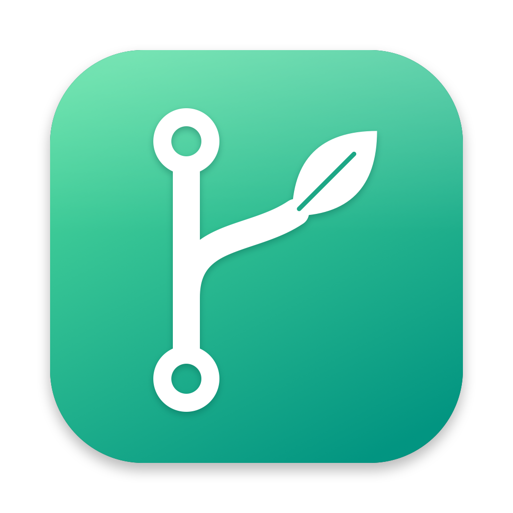
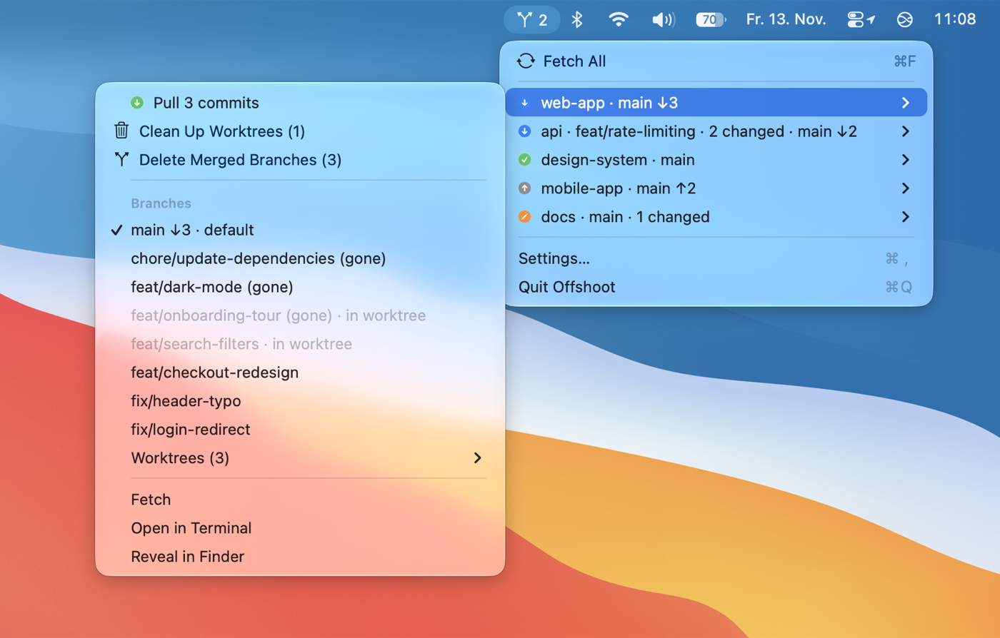
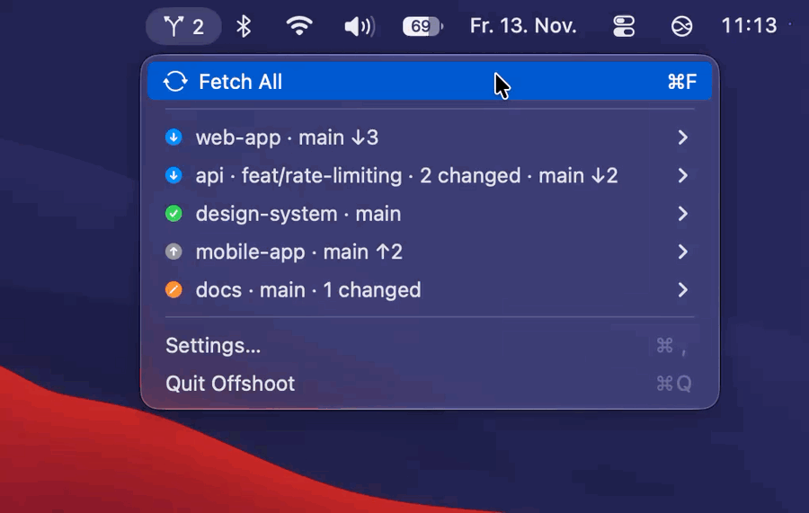
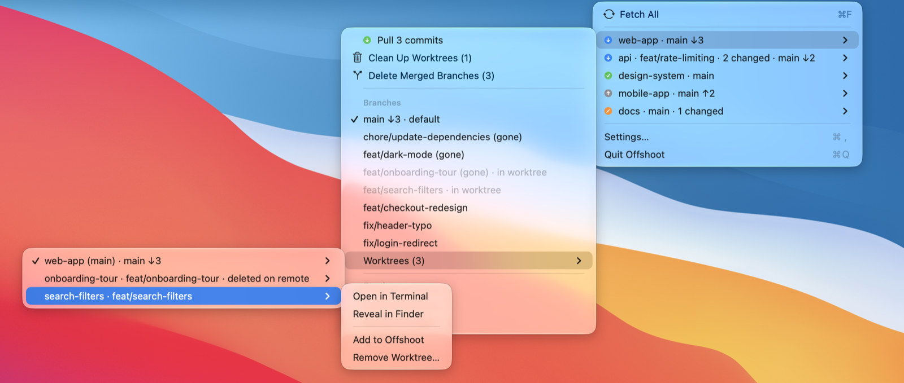
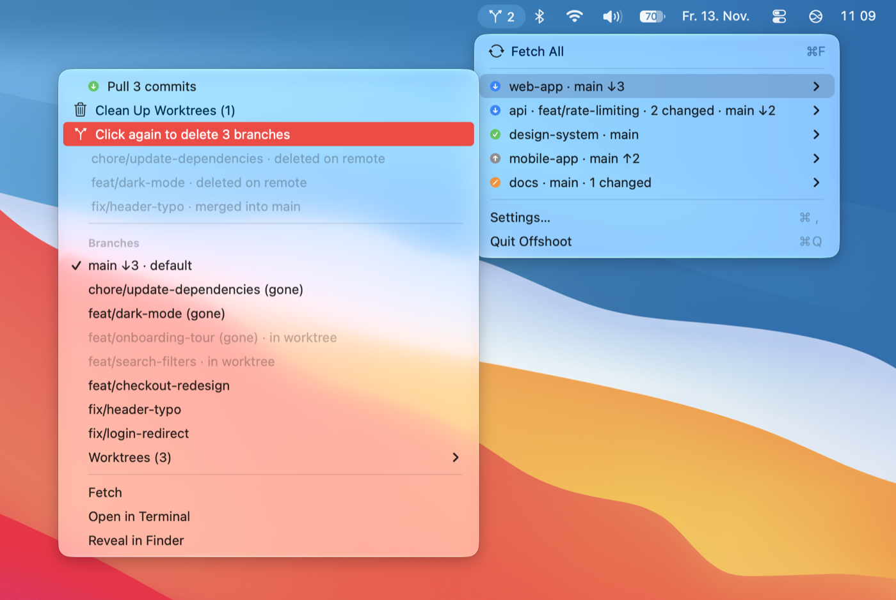
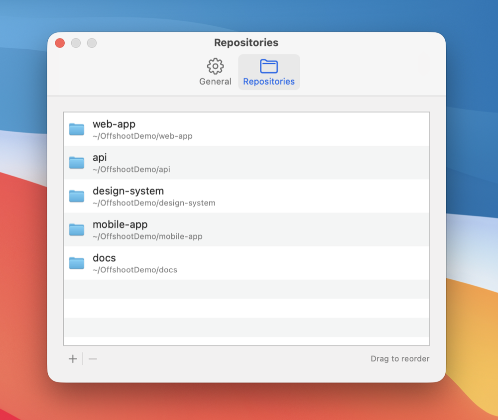

<p align="center">
  
</p>

<h1 align="center">Offshoot</h1>

<p align="center">
  Switch branches and pull your everyday git repositories from the macOS menu bar.<br>
  Made for working with AI coding agents across many projects, without an IDE.
</p>

<p align="center">
  <a href="https://github.com/JakobFelixJulius/offshoot/actions/workflows/ci.yml"></a>
  <a href="https://github.com/JakobFelixJulius/offshoot/releases/latest"></a>
  
  <a href="LICENSE"></a>
</p>

Offshoot is a small, native menu bar app for the handful of local checkouts you work in every day. It shows which branch each one is on and whether it is behind, and gets you to the latest code in one or two clicks. It is not a GitHub dashboard: no issues, stars or activity feeds, just your working copies.

<p align="center">
  <picture>
    <source media="(prefers-color-scheme: dark)" srcset="docs/images/menu-dark.png">
    
  </picture>
</p>

## Why Offshoot

Offshoot is built for working with AI coding agents on several projects at once.

When you spend your day in an agent client instead of an IDE, such as the Claude desktop app, Claude Code in a terminal or a similar tool, you lose the small branch indicator an IDE keeps in its status bar. Agents create branches, commit, switch checkouts and spin up worktrees across many repositories, often in parallel and often while you are looking at something else. Before you start the next task, two questions come up again and again:

- **Which branch is this repository's main checkout on right now?** An agent may have left it on a feature branch from an earlier task.
- **Is it up to date?** Teammates and other agents keep merging, so the default branch you are about to build on is often several commits behind.

Answering that means opening a terminal per repository and running `git status` and `git fetch`. Offshoot answers it from the menu bar for all of your repositories at once:

1. Glance at the menu: every repository shows its current branch, how far it is behind, and whether it has uncommitted changes.
2. If a checkout was left on an old feature branch, switch it back to the default branch in two clicks.
3. Click **Fetch All** and watch each repository update, then hand the agent a checkout that is current.

<p align="center">
  
</p>

Background fetches only refresh the counts and never move a checkout, so Offshoot is safe to run while agents are working in the same repositories.

### Is it for you?

Offshoot fits if you keep several local checkouts current, work with coding agents or worktrees, or spend your day outside an IDE. It is deliberately not a git client: there is no staging, committing, diffing, merging or conflict resolution, and no issue or pull request browser. For those, keep using Fork, Tower, GitKraken, `lazygit` or your IDE. Offshoot answers one question that none of them put in the menu bar: *where does each of my checkouts stand right now, and can I update it in one click?*

## Features

- **At a glance**: one menu item per repository with its branch, ↓ behind / ↑ ahead counts, uncommitted changes, and a colored status badge.
- **Switch branches**: hover a repository and pick a branch. The default branch is listed first; remote-only branches are one level deeper and get a tracking branch when you pick them.
- **Pull**: appears when the branch can fast-forward; fetches and runs `git merge --ff-only`, so a `pull.rebase` setting never applies.
- **Stale default branch**: on a feature branch, Offshoot shows when `main` (or `dev`) is behind and fast-forwards it from its own upstream without checking it out.
- **Worktrees**: see every worktree of a repository with its branch and ahead/behind counts, open one in Terminal or Finder, or add it to Offshoot. Branches checked out in another worktree are marked, so you know why they can't be switched to.
- **Clean Up Worktrees**: removes the worktrees agents leave behind once their branch is merged, plus records of worktrees whose folder is gone.
- **Delete Merged Branches**: deletes local branches that are merged (see below), including squash merges that `git branch -d` never recognizes.
- **Fetch All** (⌘F): fetches every repository, then fast-forwards what can move safely.
- **Background fetch**: keeps the counts current every 5–60 minutes (or never).
- **Native**: a standard macOS menu with keyboard navigation and VoiceOver support, light and dark mode, launch at login.

<p align="center">
  <picture>
    <source media="(prefers-color-scheme: dark)" srcset="docs/images/worktrees-dark.png">
    
  </picture>
</p>

### Safe by design

Offshoot never discards work. It only fast-forwards (`--ff-only`), never merges, rebases or resets, and skips any branch with uncommitted changes or its own unpushed commits. Background fetches only update remote-tracking refs and never touch your checkouts, so it is safe to run next to an IDE or a coding agent working in the same repository. When git refuses something, Offshoot shows git's own message in that repository's menu. Switching branches warns when uncommitted changes would move along.

### Cleaning up branches and worktrees

Both cleanups keep the menu open. The first click lists exactly what will go and why, right below the row; a second click within 15 seconds runs it.

<p align="center">
  <picture>
    <source media="(prefers-color-scheme: dark)" srcset="docs/images/cleanup-preview-dark.png">
    
  </picture>
</p>

A branch counts as merged when one of these holds:

1. **Merged into the default branch**: every commit is in `origin/main` (or your default branch), which git can prove. Only for branches that were pushed at some point, so a branch you just created is never touched.
2. **Pull request merged** (with GitHub CLI, see below): its pull request was merged and holds every commit of the local branch. If the merged commit isn't local, Offshoot fetches it from GitHub's `refs/pull/<number>/head` to check. Branches with commits that never reached the pull request, or whose pull request was closed without merging, are kept.
3. **Deleted on the remote** (without GitHub CLI): the remote branch was deleted, which usually follows a merge.

Never touched: the default branch, the branch you are on, and anything checked out in a worktree. Right before deleting, Offshoot checks again that each branch still points at the commit it listed, so a branch an agent committed to in the meantime is kept. Worktree folders are removed with `git worktree remove` without `--force`: git keeps any worktree with uncommitted or untracked changes, and ignored files such as `.env` or `node_modules` go with the folder.

Each deleted branch's last commit is written to the system log (Console, search "Offshoot"), so `git branch <name> <sha>` restores it within about two weeks, before git's garbage collection removes unreferenced commits.

### GitHub CLI (optional)

Turn on **Check pull requests with GitHub CLI** in Settings → General to use rule 2 instead of rule 3. It needs the [GitHub CLI](https://cli.github.com) installed and signed in (`gh auth login`), and uses that sign-in. It is off by default; repositories not on GitHub keep using rule 3.

## Install

Requires macOS 14 Sonoma or later, on Apple silicon or Intel.

### Homebrew

```bash
brew tap JakobFelixJulius/offshoot https://github.com/JakobFelixJulius/offshoot
brew trust JakobFelixJulius/offshoot
brew install --cask offshoot
```

Homebrew asks you to trust third-party taps once; `brew trust` does that for this one.

### Download

Download `Offshoot-<version>.zip` from the [latest release](https://github.com/JakobFelixJulius/offshoot/releases/latest), unzip it and move `Offshoot.app` to `/Applications`.

### First launch

Release builds are not notarized by Apple yet, so macOS blocks the first launch. Open it once like this:

1. Open Offshoot. macOS says it cannot verify the developer; click **Done**.
2. Go to **System Settings → Privacy & Security**, scroll down and click **Open Anyway** next to Offshoot.

Alternatively, remove the quarantine flag in Terminal:

```bash
xattr -dr com.apple.quarantine /Applications/Offshoot.app
```

### Build from source

```bash
git clone https://github.com/JakobFelixJulius/offshoot.git
cd offshoot
scripts/build-app.sh --install
```

This builds with your local toolchain (Xcode 16 or later), signs ad hoc, copies the app to `~/Applications` and launches it.

## Usage

1. Click the Offshoot icon in the menu bar and choose **Settings…** (⌘,).
2. Under **Repositories**, click **+** and pick one or more git checkouts. Drag to reorder.

   <picture>
     <source media="(prefers-color-scheme: dark)" srcset="docs/images/settings-repositories-dark.png">
     
   </picture>

3. Under **General**, turn on **Launch at login** and choose a background fetch interval and menu bar icon. If you use the GitHub CLI, turn on **Check pull requests with GitHub CLI** for stricter branch cleanup.

The number next to the menu bar icon is how many repositories have something to pull.

| Status | Meaning |
| --- | --- |
| 🟢 ✓ | Up to date with its upstream |
| 🔵 ↓ | Behind: the branch or the default branch can be updated |
| 🟠 ✎ | Uncommitted changes |
| 🟠 ⇅ | Diverged from its upstream; resolve it in your usual git tool |
| ⚪ ↑ | Only ahead: you have commits to push |
| 🔴 ! | git reported an error; details at the top of the repository's menu |
| ⚪ ⟳ | Working: fetching, switching or cleaning up |

Offshoot runs `/usr/bin/git` with your normal git configuration, SSH keys and credential helpers. It never prompts for credentials; a repository that needs them shows an error instead.

## FAQ

**Why not just use a git GUI?** Offshoot is for the moment between tasks: check where every checkout stands and update it, without opening a window. A git client shows one repository in depth; Offshoot shows all of them at a glance.

**Does it work with GitHub Enterprise, GitLab or Bitbucket?** Yes. Everything except the optional pull request check is plain git, so any remote works. The GitHub CLI option follows whatever host your `gh` is signed in to.

**Does it work with worktrees?** Yes. Each repository's menu has a Worktrees submenu, which is handy when agents create worktrees for parallel tasks. To track a worktree's own branch and status, choose **Add to Offshoot** on it.

**Where are settings stored?** In `~/Library/Preferences/io.github.jakobfelixjulius.offshoot.plist`. Offshoot has no network access of its own beyond the git commands it runs, plus `gh pr list` when the GitHub CLI option is on. It collects no analytics.

## Contributing

Bug reports, ideas and pull requests are welcome. See [CONTRIBUTING.md](CONTRIBUTING.md) to get started, and please follow the [Code of Conduct](CODE_OF_CONDUCT.md). Report security issues privately as described in [SECURITY.md](SECURITY.md).

## License

[MIT](LICENSE) © Jakob Felix Julius Sudau
